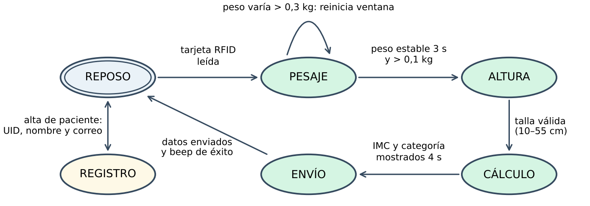

# Documento de Diseño: SmartHealth

**Estación de triaje nutricional para control pediátrico**

Jaimar David Salazar Cabrera · 15 de noviembre de 2026 · [github.com/Jai-Dasix/SmartHealth](https://github.com/Jai-Dasix/SmartHealth)

## 1. Introducción

SmartHealth es un equipo que toma el peso y la talla de bebés y niños pequeños (hasta 50 cm y 5 kg), calcula su índice de masa corporal (IMC), lo clasifica y guarda el resultado en internet junto con la fecha y la hora. En muchos consultorios esto todavía se hace a mano: se lee la báscula, se mide con una cinta, se calcula y se anota en papel. Así es fácil equivocarse y cuesta seguir cómo evoluciona cada niño. La idea es tener una sola estación, portátil y económica (unos 70 dólares en materiales), que haga todo el proceso, reduzca los errores y deje un historial por paciente.

Con el proyecto se busca pesar solo cuando la lectura es estable, medir la talla con un sensor láser, controlar el proceso con una máquina de estados, enviar los resultados por Wi-Fi y cuidar los datos del niño.

## 2. Alcance y limitaciones

**Qué se va a crear**

- Una plataforma con la balanza, el ESP32, el lector de tarjetas, la pantalla, el buzzer y la batería, y un soporte de pared con el sensor láser para la talla.
- El programa que controla los pasos, calcula el IMC y dice si hay bajo peso, peso normal, sobrepeso u obesidad.
- Tarjetas RFID para identificar a cada niño.
- Una página web en el propio equipo para iniciar pesajes, registrar pacientes y ajustar el hardware.
- El guardado del historial en Firebase y un correo al representante con el resultado.

**Qué problemas no se resuelven**

- No da un diagnóstico. El resultado ayuda al triaje y no reemplaza al pediatra.
- No usa las curvas completas de la OMS por edad y sexo, sino rangos de IMC aproximados. Eso queda como mejora.
- No sirve para niños más grandes ni para adultos.
- No tiene certificación como instrumento médico.
- Necesita Wi-Fi al encenderse; sin red no arranca.
- No mide otras cosas, como el perímetro de la cabeza o la temperatura.

## 3. Diagrama de contexto

*Figura 1. Diagrama de contexto*

El operador, que es el personal de salud, maneja el equipo desde la página web y ve los resultados en la pantalla. El niño aporta su peso, su talla y su tarjeta. Fuera del equipo están la red Wi-Fi, un servidor de hora, Firebase, donde se guarda el historial, y Google Apps Script, que manda el correo al representante. En resumen, el sistema tiene tres partes: la base que pesa y procesa, el soporte que mide la talla y los servicios en internet.

## 4. Diagrama de bloques del diseño

*Figura 2. Diagrama de bloques*

- **ESP32.** Es el cerebro: controla los pasos, hace los cálculos, publica la página web y se conecta a internet.

- **Celda de carga y HX711.** La celda siente el peso y el HX711 convierte esa señal en un número.

- **Sensor láser VL53L0X.** Mide la distancia al niño; la talla sale de restar esa distancia a una referencia fija de 60 cm.

- **Lector RFID RC522.** Lee la tarjeta del niño para saber de quién es el pesaje.

- **Pantalla OLED y buzzer.** Muestran los mensajes y avisan con sonidos al empezar, al fijar una medida y al terminar (el buzzer va en el GPIO 25).

- **Baterías, TP4056 y LM7805.** Dan energía para mover el equipo, se cargan por USB y entregan 5 V estables.

## 5. Diagrama de software: máquina de estados

*Figura 3. Máquina de estados del programa*

El programa solo pasa al siguiente estado cuando se cumple una condición, así una medida inestable nunca llega al cálculo. En PESAJE el peso debe mantenerse casi igual durante 3 segundos (cambios menores a 0,3 kg) y ser mayor a 0,1 kg; si el niño se mueve, el conteo empieza de nuevo. En ALTURA se promedian varias lecturas del láser y se descartan las malas; si la talla sale fuera de 10 a 55 cm, se mide otra vez. En CÁLCULO se obtiene el IMC (peso dividido para la talla al cuadrado) y se clasifica: menos de 13 es bajo peso, hasta 18 normal, hasta 20 sobrepeso y más de 20 obesidad. En ENVÍO se guarda el registro y se manda el correo. REGISTRO sirve para dar de alta a un paciente desde la web, y un pesaje en curso se puede cancelar para volver a REPOSO.

## 6. Diagrama y diseño de interfaces

| **Conexión**                  | **Tipo**              | **Detalle**                                                                                                         |
|-------------------------------|-----------------------|---------------------------------------------------------------------------------------------------------------------|
| Celda de carga, HX711 y ESP32 | Dos cables (DT y SCK) | DT en el GPIO 16 y SCK en el GPIO 4. El factor de escala se ajusta con pesas conocidas.                             |
| Sensor láser y pantalla       | I2C, mismo bus        | SDA en el GPIO 21 y SCL en el GPIO 22. La pantalla usa la dirección 0x3C.                                           |
| Lector RFID                   | SPI                   | SS en 5, SCK en 18, MISO en 19, MOSI en 23 y RST en 27, alimentado a 3,3 V.                                         |
| Operador y ESP32              | Página web (HTTP)     | La página pide el estado cada segundo a /api/datos_en_vivo y recibe estado, paciente, peso, talla, IMC y categoría. |
| ESP32 y Firebase              | Internet (HTTPS)      | Guarda peso, talla, IMC y categoría en /Pacientes/{id}/historial_pesajes/{fecha y hora}.                            |
| ESP32, Apps Script y hora     | Internet              | Envía los datos para armar el correo. La hora se pide a un servidor NTP (UTC−5).                                    |

## 7. Alternativas de diseño

| **Decisión**        | **Otras opciones**                                                 | **Lo que se eligió y por qué**                                                                                                                                                  |
|---------------------|--------------------------------------------------------------------|---------------------------------------------------------------------------------------------------------------------------------------------------------------------------------|
| Medir la talla      | Sensor ultrasónico o cinta métrica                                 | Láser VL53L0X, porque es más preciso, se confunde menos con rebotes y comparte el bus I2C con la pantalla. Su punto débil es la luz fuerte del sol.                             |
| Medir el peso       | Una sola lectura                                                   | Se promedian lecturas y se espera 3 segundos de estabilidad, porque un niño se mueve mucho.                                                                                     |
| Identificar al niño | Escribir los datos a mano                                          | Tarjeta RFID: es más rápida y evita escribir el nombre en cada visita.                                                                                                          |
| Guardar los datos   | ThingSpeak (primera idea)                                          | Firebase, que permite ordenar el historial por paciente y fecha. El correo sale por Apps Script, sin servidor propio.                                                           |
| Conexión a internet | Guardar dos redes y crear una red propia del equipo (primera idea) | Para el prototipo se dejó una sola red en un archivo de configuración, que es más simple. Cambiar de red obliga a volver a cargar el programa; la red propia queda como mejora. |
| Interfaz y energía  | Solo pantalla OLED; solo cable USB                                 | Pantalla y página web juntas, para guiar el pesaje y registrar pacientes sin reprogramar, y baterías recargables para mover el equipo.                                          |

## 8. Plan de test y validación

| **Qué se prueba**  | **Cómo**                                                                                                                                               | **Se considera correcto si**                                                        |
|--------------------|--------------------------------------------------------------------------------------------------------------------------------------------------------|-------------------------------------------------------------------------------------|
| Balanza            | Con la plataforma vacía y con pesas conocidas de 0,5; 1; 2 y 5 kg.                                                                                     | El error es de hasta 50 g.                                                          |
| Sensor de talla    | Objetos a 10, 20, 30, 40 y 50 cm medidos con flexómetro, con 10 lecturas en cada uno.                                                                  | El error es de hasta 1 cm.                                                          |
| Tarjetas y cálculo | 20 lecturas de una tarjeta registrada y de otra que no lo está; valores justo en los límites del IMC (13, 18 y 20) y algunos casos hechos a mano.      | Se lee bien el código y la categoría coincide con lo esperado.                      |
| Proceso completo   | 10 pruebas completas con un muñeco de peso y largo conocidos, revisando que la página web muestre lo mismo que la pantalla.                            | Todas terminan sin trabarse y el dato llega a Firebase y al correo.                 |
| Casos difíciles    | Balanza vacía, niño que se mueve, más de 5 kg, talla fuera de rango, láser sin lectura, Wi-Fi caído al enviar, tarjeta desconocida y pesaje cancelado. | El equipo no avanza, no guarda datos malos, no se cuelga y vuelve a REPOSO.         |
| Comparación y uso  | Al menos 10 mediciones frente a la báscula y el tallímetro de un consultorio, y una persona sin experiencia usando el equipo.                          | Diferencia de hasta 1 % en peso y 1 cm en talla, y la persona logra un pesaje sola. |

## 9. Consideraciones éticas

- **Datos de niños.** Se guardan peso, talla y estado nutricional de menores, además del correo del representante. Por eso en la nube solo se usa el código de la tarjeta, el nombre se queda en el equipo, se pide permiso al representante y la página web se usa solo dentro de la red del centro.

- **Resultados mal entendidos.** Alguien podría tomar la categoría como un diagnóstico. El correo recomienda hablar con el pediatra y se aclara que los rangos son aproximados.

- **Errores de medición.** Un valor mal medido puede alarmar o tranquilizar sin motivo. Se calibra con pesas conocidas, se rechazan las lecturas inestables y se comparan los datos con los instrumentos del consultorio. A futuro se usarían las tablas de la OMS por edad y sexo.

- **Seguridad de la información.** Las claves del Wi-Fi y de la nube no se suben al repositorio. Antes de usar el equipo con pacientes reales hay que cerrar el acceso público de Firebase con autenticación y proteger el servicio que envía los correos.

- **Uso responsable.** Un equipo económico ayuda a centros con pocos recursos y a detectar a tiempo el bajo peso o la obesidad, pero no debe reemplazar al personal de salud, y el niño siempre debe estar vigilado sobre la plataforma.
