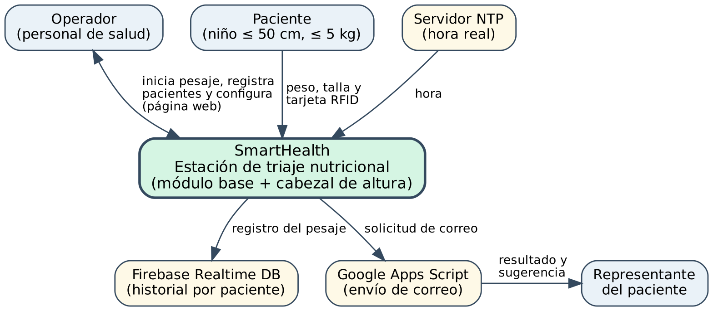
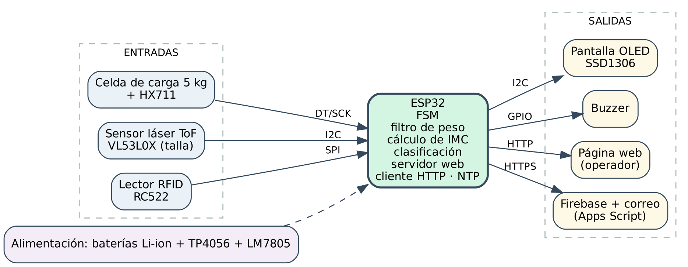

# SmartHealth: Documento de Diseño

Estación de triaje nutricional automatizada para control pediátrico (hasta 50 cm y 5 kg).

**Autor:** Jaimar David Salazar Cabrera · 15 Noviembre de 2026

## 1. Introducción

SmartHealth es un sistema embebido que automatiza la toma de peso y talla de niños de hasta 50 cm y 5 kg, calcula su Índice de Masa Corporal (IMC), lo clasifica nutricionalmente y registra cada medición con marca de tiempo en la nube. En consultas y centros de salud este proceso se hace en gran parte a mano (lectura de báscula y tallímetro, cálculo y transcripción a una ficha en papel), lo que produce errores de lectura, de cálculo y de transcripción y dificulta el seguimiento del historial de cada niño. El objetivo es ofrecer una sola estación portátil y de bajo costo (unos US$ 70 en componentes) que reúna ambas mediciones, reduzca el error humano y deje un historial consultable por paciente.

**Objetivos específicos:**

1. Medir el peso con celda de carga aceptando solo lecturas estables.
2. Medir la talla con un sensor láser de tiempo de vuelo.
3. Gestionar el flujo completo con una máquina de estados finitos.
4. Registrar y notificar los resultados por Wi-Fi.
5. Proteger la privacidad del paciente y dejar claro que el equipo apoya al triaje, no diagnostica.

## 2. Alcance y limitaciones

**Qué se va a crear**

- Dos módulos físicos: plataforma de peso (celda de carga de 5 kg con HX711, ESP32, lector RFID, OLED, buzzer y batería) y cabezal de altura fijado a la pared (sensor láser VL53L0X).
- Firmware con máquina de estados: filtro de estabilidad del peso, cálculo de IMC y categoría (bajo peso, normopeso, sobrepeso, obesidad).
- Identificación por tarjeta RFID asociada a un paciente y al correo de su representante.
- Página web servida por el ESP32 para iniciar pesajes, registrar o borrar pacientes y configurar el hardware.
- Registro en Firebase (historial por paciente con marca de tiempo) y correo con el resultado.

**Qué problemas NO se resuelven**

- Diagnóstico clínico: la categoría es orientativa y no sustituye la valoración del pediatra.
- Clasificación con curvas z-score completas de la OMS por edad y sexo: se usan umbrales de IMC orientativos; las tablas z-score quedan como trabajo futuro.
- Pacientes fuera del rango de 50 cm y 5 kg (niños mayores, adultos).
- Certificación metrológica o sanitaria del instrumento.
- Operación sin red: el equipo necesita Wi-Fi al iniciar (hora NTP y nube); cambiar de red exige reconfigurar el firmware.
- Otras variables (perímetro cefálico, temperatura) o análisis de tendencias de crecimiento.

## 3. Diagrama de contexto

El **operador** (personal de salud) controla el equipo desde la página web del ESP32 y lee los resultados en la pantalla OLED, con un beep como confirmación. El **paciente** aporta su peso sobre la plataforma, su talla frente al sensor láser y, de forma opcional, su tarjeta RFID. El entorno está formado por la red Wi-Fi, un servidor NTP que entrega la hora real, Firebase Realtime Database (historial) y Google Apps Script, que envía el correo al **representante**. Los bloques principales son el módulo base (peso, cómputo e interfaz), el cabezal de altura (talla) y los servicios en la nube (persistencia y notificación).

## 4. Diagrama de bloques del diseño

| Componente | Función en el sistema |
|---|---|
| ESP32 (DevKit) | Unidad central: ejecuta la máquina de estados, filtra el peso, calcula IMC y categoría, sirve la página web, envía datos a la nube y mantiene la hora por NTP. |
| Celda de carga 5 kg + HX711 | La celda convierte la fuerza en un voltaje muy pequeño; el HX711 lo amplifica y digitaliza a 24 bits. |
| Sensor láser VL53L0X | Mide la distancia por tiempo de vuelo desde el cabezal; la talla es la distancia de referencia (60 cm) menos la distancia medida. |
| Lector RFID RC522 | Lee el UID de la tarjeta para identificar al paciente sin ingresar datos a mano. |
| OLED SSD1306, buzzer | Muestran instrucciones, IP y resultados; el buzzer emite tonos de inicio, de medida bloqueada y de éxito. |
| Baterías Li-ion, TP4056, LM7805 | Hacen el equipo autónomo, permiten la carga por USB con protección y regulan la tensión a 5 V. |

## 5. Diagrama de software: máquina de estados

El firmware avanza solo cuando se cumple la condición de cada transición, por lo que una medición inestable nunca llega al cálculo.

- **PESAJE:** se promedian tres lecturas y se exige que el peso varíe menos de 0,3 kg durante 3 s y supere 0,1 kg; si varía, la ventana se reinicia.
- **ALTURA:** se promedian cinco lecturas del láser descartando las inválidas; si la talla queda fuera de 10 a 55 cm se repite la medida.
- **CÁLCULO:** IMC = peso / talla²; menos de 13 bajo peso, de 13 a 18 normopeso, más de 18 hasta 20 sobrepeso, mayor a 20 obesidad.
- **ENVÍO:** guarda el registro en Firebase y solicita el correo.
- **REGISTRO:** atiende el alta de pacientes desde la página web. Un pesaje en curso puede abortarse desde ella para volver a REPOSO.

## 6. Diagrama y diseño de interfaces

| Enlace | Tipo | Detalle |
|---|---|---|
| Celda de carga / HX711 – ESP32 | Serie síncrona 2 hilos | DT = GPIO 16, SCK = GPIO 4. El factor de escala se obtiene con una rutina de calibración con masa conocida. |
| VL53L0X y OLED – ESP32 | I2C compartido | SDA = GPIO 21, SCL = GPIO 22; la pantalla responde en 0x3C. |
| RC522 – ESP32 | SPI | SS = GPIO 5, SCK = 18, MISO = 19, MOSI = 23, RST = 27; alimentado a 3,3 V. |
| Buzzer – ESP32 | GPIO digital | GPIO 25; un tono distinto por evento. |
| Operador – ESP32 | HTTP, puerto 80 | Página web con menú principal (iniciar pesaje, registrar paciente, configurar hardware), medición en vivo y base de pacientes. Consulta cada 1 s a `/api/datos_en_vivo`, que devuelve en JSON estado, paciente, peso, talla, IMC y categoría. |
| ESP32 – Firebase | HTTPS | Escribe en `/Pacientes/{id}/historial_pesajes/{marca de tiempo}` los campos `peso_kg`, `altura_cm`, `imc` y `categoria`. |
| ESP32 – Apps Script | HTTPS, POST JSON | Envía `email`, `paciente`, `peso`, `altura`, `imc`, `categoria` y una `sugerencia` según la categoría. |
| ESP32 – servidor NTP | UDP (NTP) | Hora local UTC−5 para las marcas de tiempo. |

## 7. Alternativas de diseño

| Decisión | Alternativas analizadas | Elegida y justificación |
|---|---|---|
| Sensor de talla | Ultrasónico (HC-SR04, JSN-SR04T); medición manual | **Láser ToF VL53L0X:** haz estrecho, menos falsos rebotes que el ultrasonido, resolución milimétrica, I2C y bus compartido con la OLED. Limitación: sensible a luz intensa y superficies muy reflectivas. |
| Peso | Lectura única; promedio simple | **Promedio de 3 muestras con ventana de estabilidad de 3 s:** evita registrar el movimiento del niño. |
| Identificación | Ingreso manual; sin identificación | **RFID RC522:** rápido, sin teclear y permite historial por paciente; el UID por sí solo no revela la identidad. |
| Nube | ThingSpeak (propuesta inicial); Firebase | **Firebase Realtime DB:** estructura jerárquica por paciente y marca de tiempo, librería para ESP32; el correo sale por Apps Script sin servidor propio. ThingSpeak, pensada para canales de series numéricas, modela peor un historial por paciente. |
| Conectividad | Dos redes en EEPROM + modo Access Point (propuesta inicial); credenciales en el firmware | **Credenciales en un archivo de configuración y página web en la IP del equipo:** menor complejidad para el prototipo. Costo: cambiar de red exige recompilar; el modo Access Point queda como mejora. |
| Interfaz | Solo OLED y consola serie; OLED + página web | **OLED + página web:** la pantalla guía el pesaje en sitio y la página permite registrar pacientes y activar o desactivar módulos sin reprogramar. |
| Alimentación | Solo USB; baterías | **Baterías Li-ion con TP4056 y LM7805:** portabilidad en consultorios y escuelas. |

## 8. Plan de test y validación

| Nivel | Prueba y casos específicos | Criterio de aceptación |
|---|---|---|
| Unitaria | **Calibración del HX711:** tara con la plataforma vacía y masas patrón de 0,5; 1; 2 y 5 kg. | Error ≤ ±50 g (1 % a 5 kg); deriva de cero ≤ 20 g en 10 min. |
| Unitaria | **Talla con VL53L0X:** objetos a 10, 20, 30, 40 y 50 cm medidos con flexómetro, 10 lecturas cada uno. | Error ≤ ±1 cm; desviación estándar ≤ 0,3 cm. |
| Unitaria | **RFID:** 20 lecturas por tarjeta registrada y por una no registrada. | UID correcto en 20/20; la tarjeta desconocida se identifica por su UID sin fallar. |
| Unitaria | **IMC y categoría:** valores frontera (12,9; 13,0; 18,0; 18,1; 20,0; 20,1) y 5 casos calculados a mano. | Categoría y valor coinciden con lo esperado. |
| Integración | **Flujo completo** REPOSO → PESAJE → ALTURA → CÁLCULO → ENVÍO → REPOSO con un maniquí de masa y longitud conocidas, 10 repeticiones. | 10/10 ciclos completos, sin bloqueos. |
| Integración | **Página web y nube:** estado en vivo, alta y borrado de pacientes, abortar pesaje; registro en Firebase y correo tras cada pesaje. | El estado web coincide con la OLED en ≤ 2 s; el registro tiene ruta, campos y marca de tiempo correctos; el correo llega. |
| Casos límite | Plataforma vacía o < 0,1 kg; movimiento durante el pesaje; peso > 5 kg; talla fuera de 10–55 cm; láser sin lectura; pérdida de Wi-Fi al enviar; tarjeta no registrada; pesaje abortado. | No avanza de estado, no registra datos inválidos, no se bloquea y vuelve a REPOSO. |
| Validación | **Contra instrumento de referencia** (báscula y tallímetro de consulta), al menos 10 mediciones, y **prueba de uso** con un operador sin experiencia. | Diferencia media ≤ 1 % en peso y ≤ 1 cm en talla; el operador completa un pesaje sin ayuda. |

## 9. Consideraciones éticas

- **Datos de menores.** Se manejan peso, talla y estado nutricional de niños, además del nombre y el correo de su representante. Mitigación: el historial en la nube se indexa por el código de la tarjeta (UID) y el nombre y el correo permanecen en el equipo; se solicita consentimiento informado al representante; el acceso a la página web se limita a la red local del centro.
- **Interpretación errónea.** La categoría podría tomarse como diagnóstico. Mitigación: aviso de que es una herramienta de apoyo al triaje, sugerencia en el correo que remite al pediatra y documentación de que los umbrales son orientativos.
- **Error de medición y sesgo.** Sin curvas por edad y sexo, un valor mal clasificado puede tranquilizar o alarmar sin motivo. Mitigación: calibración periódica con masas patrón, rechazo de lecturas inestables o fuera de rango, validación contra instrumentos de referencia y adopción futura de tablas z-score de la OMS.
- **Seguridad de la información.** Las credenciales Wi-Fi y de nube y el endpoint de correo pueden ser abusados. Mitigación: secretos en un archivo de configuración excluido del repositorio, reglas de Firebase con autenticación y restricción del endpoint de correo.
- **Seguridad física e impacto social.** Plataforma estable, sin bordes filosos, batería con protección de carga y niño siempre supervisado. El bajo costo favorece el acceso en centros con pocos recursos y la detección temprana de bajo peso y obesidad, con el riesgo de delegar el criterio clínico a la máquina, que se previene con el aviso y la supervisión profesional.
